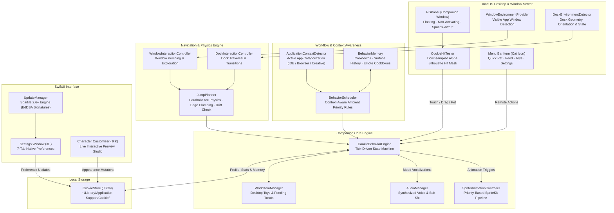
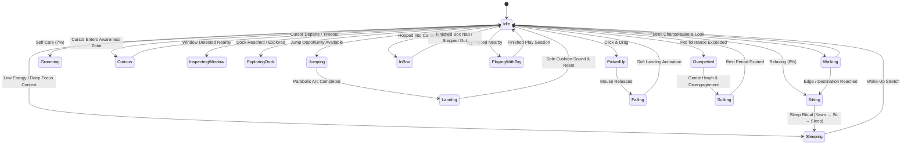

<div align="center">

  

  # Cookie 🐱

  **A quiet, warm, intelligent desktop companion that lives on your Mac.**  
  *No subscriptions. No cloud accounts. No telemetry. Just a delightful companion right on your desktop.*

  [-262421?style=flat-square&logo=apple&logoColor=white)](https://apple.com)
  [](https://github.com/MdKasif0/Cookie/releases)
  [-5d4d40?style=flat-square)](https://github.com/MdKasif0/Cookie)
  [](https://developer.apple.com/swift/)
  [-262421?style=flat-square)](website/appcast.xml)
  [](LICENSE)
  [](website/#privacy)
  [](https://github.com/MdKasif0/Cookie/releases)

</div>

---

## 📖 Overview

**Cookie** is a lightweight, offline desktop companion for macOS built natively with **SwiftUI** and **SpriteKit**. She roams your screen, leaps between open windows and the Dock, follows your cursor, and naps quietly beside your work—whisper-quiet on hardware (~0% idle CPU), zero telemetry, and completely non-intrusive.

---

## ✨ Key Features

| Feature | Highlight |
| :--- | :--- |
| **🐾 Desktop Companion** | Borderless floating panel that lives across all macOS Spaces without stealing focus. |
| **🪟 Window & Dock Jumping** | Traverses window edges and the macOS Dock with parabolic physics leaps. |
| **🧠 Context Awareness** | Automatically adapts energy and curiosity to your active workflow (IDEs, browsers). |
| **🫳 Tactile Interactions** | Zone-aware petting, physics dragging, and transparent click-through hit testing. |
| **🧶 Toys & Treats** | Interactive desktop items (yarn, mouse, cardboard box) and snack rewards. |
| **🎨 Character Studio (⌘K)** | 10 fur palettes, coats, eye styles, body scaling, and layered accessories. |
| **🎵 Synthesized Audio** | Procedural purrs, chirps, and meows with independent volume buses. |
| **🔒 100% Private & Offline** | Zero analytics, zero cloud dependencies, and local JSON storage. |
| **🔄 Seamless Updates** | Secure in-app updates via Sparkle with cryptographic EdDSA verification. |

---

## 🏗️ Architecture & Engine

### High-Level System Architecture



---

### Behavior State Machine

Cookie's behavior is driven by `CookieBehaviorEngine` and `BehaviorScheduler`. Rather than acting like a restless toy, Cookie behaves like a real companion with weighted probabilities, natural durations, and anti-annoyance cooldowns:



---

## 🪟 Intelligent Window & Surface Jumping

Cookie is equipped with a physics-backed jump engine (`JumpPlanner`) capable of traversing macOS application windows and the Dock:

* **Parabolic Trajectory Math**: Calculates realistic launch velocities, flight duration, peak altitude, and landing angles.
* **Tuned Physical Reach**:
  * Maximum horizontal leap: **340 pt**
  * Maximum vertical upward leap: **175 pt**
  * Maximum downward drop: **260 pt**
  * Minimum landing width required: **75 pt**
* **Safe Landing Corridors**: Automatically clamps landing coordinates within the safe top-edge boundaries of target windows so Cookie never lands awkwardly off the edge.
* **Pre-Launch Drift Cancellation**: If the user moves or resizes the destination window while Cookie is crouching to jump, the system immediately cancels the jump and gracefully returns to a ground stroll.
* **Anti-Ping-Pong Cooldowns**: Prevents repetitive bouncing between the same pair of windows (45-second surface cooldown).

---

## 🧭 macOS Dock Traversal

The `DockEnvironmentDetector` and `DockInteractionController` integrate Cookie with your macOS setup:

* **Geometry & Orientation Awareness**: Detects whether the Dock is pinned to the **Bottom**, **Left**, or **Right** of the screen across single and multi-monitor setups.
* **Dock Autohide Support**: Respects autohidden Dock states and dynamically recalculates usable desktop bounds.
* **Dock Exploration**: Cookie can step onto the Dock, observe running application icons, glance at notifications, and safely jump back down to the desktop floor.

---

## 🧠 Context-Aware Ambient Engine

Cookie observes her environment without invading privacy. The `ApplicationContextDetector` classifies the active application category solely from bundle identifiers and localized app names:

* **Code Editors & IDEs** (`Xcode`, `VS Code`, `Cursor`, `Sublime`, `Zed`): Cookie adopts a calm, whisper-quiet demeanor, sleeping or quietly sitting beside your editor.
* **Web Browsers** (`Safari`, `Chrome`, `Firefox`, `Arc`, `Orion`): Cookie shows gentle curiosity, occasionally glancing at cursor movements.
* **Creative Tools** (`Figma`, `Photoshop`, `Blender`, `Logic Pro`): Cookie watches your canvas from a polite distance.
* **Communication & Other**: Cookie takes casual strolls and stretches.

> [!NOTE]
> Cookie never accesses window content, document titles, keystrokes, or screen pixels. Context detection uses public macOS `NSWorkspace` notifications exclusively.

---

## 🧶 Desktop World Items & Toys

Cookie can interact with desktop world items placed via the status menu:

### Toys
* 🧶 **Yarn Ball**: Batting and rolling across the desk.
* 🪶 **Feather**: Playful swatting and pouncing.
* 🐭 **Toy Mouse**: Curious stalking and chasing bursts.
* 🐟 **Fish Toy**: Hugging and kicking with back paws.
* 🎾 **Tennis Ball**: Bouncing nudges.
* 📦 **Cardboard Box**: Cookie hops inside, peeks over the edge, and curls up inside the box!

### Treats & Feeding
* 🐟 **Fresh Fish**: Contented munching with happy ear twitches.
* 🥛 **Bowl of Milk**: Gentle licking and drinking sounds.
* 🍗 **Chicken**: Delighted purring and joyful bounce.
* 🍪 **Cookie**: Her namesake snack, triggering a special celebration emote!

---

## 🎮 Direct Interactions

Cookie's artwork is mapped into normalized anatomical zones (`CookieZone`):

| Zone / Action | Interaction | Reaction & Effect |
| :--- | :--- | :--- |
| **Nose** | Single click | Surprised sneeze or tiny curious meow. |
| **Head & Ears** | Single click / stroke | Delighted purr, closed-eye grin, and affection gain. |
| **Belly & Body** | Click / rub | Soft meow, happy glance, or contented purr. |
| **Feet** | Single click | Playful hop and quick paw lift. |
| **Tail** | Single click | Gentle startle reaction with twitch. |
| **Pick Up** | Click & Drag | Carried pose; stroking mid-air counts as comforting petting. |
| **Drop** | Release cursor | Smooth physics drop with cushioned landing sound. |
| **Double Click** | Quick double tap | Short playful burst or enthusiastic jump. |
| **Toys & Food** | Menu Bar selection | Spawns vector item next to Cookie for immediate interaction. |
| **Over-Petting** | Exceeding tolerance | Annoyed look away ("hmph") and a brief sulk avoiding cursor play. |

---

## 🎨 Personalities & Customization

### The Six Personalities

* **😴 Sleepy**: Spends extra time curled up in deep sleep. Ideal for quiet focus sessions.
* **🧶 Playful**: Loves bouncing, double-click games, and inspecting screen elements.
* **💖 Affectionate**: High pet tolerance, frequent purring, and quick affection growth.
* **⚡ Energetic**: Fast strides, active strolls across your workspace, and lively curiosity.
* **👀 Curious**: Follows your cursor closely, tracking movements with gentle head tilts.
* **😼 Grumpy**: Lower pet tolerance, independent behavior, and dry, comical reactions.

### Customization Studio (⌘K)

Accessible directly from the menu bar or settings:
* **Fur Colors**: 10 hand-curated warm swatches (Warm White, Cream, Peach, Ginger, Caramel, Cinnamon, Mocha, Slate, Charcoal, Velvet Black). *Strictly no cold blues or harsh purples.*
* **Patterns**: Solid, Tuxedo, Siamese Points, and Tabby stripes.
* **Eye Styles**: Round, Sleepy, and Sparkle with customized iris glints.
* **Accessories**: Vector-anchored Collars, Bows, Party Hats, Glasses, Scarves, Bandanas, and Crowns.
* **Body Scale**: Classic, Chubby, and Petite options with live panel re-centering.

---

## ⚙️ Native Settings & Menu Bar

Cookie features a comprehensive, native seven-tab preference pane (⌘,):

1. **General**: Startup behavior, launch at login (`SMAppService`), desktop visibility, and multi-display coordinate recall.
2. **Appearance**: Dynamic scale slider, animation frame rate (30 / 60 FPS), and macOS Reduced Motion compliance.
3. **Sound**: Master volume, dedicated meow slider, interaction sound toggles, and ambient purring controls.
4. **Behavior**: Activity cadence (Calm / Balanced / Lively), autonomous behavior toggle & pause, cursor following/dodging intensity, window exploration & jumping toggles, dock exploration toggles, and autonomous toys.
5. **Stats**: Behavior memory metrics (total pets, favorite petting zones, jumps executed, naps enjoyed, affection level, and companionship duration).
6. **Privacy**: Statement of complete local data residency, offline operation guarantee, and zero analytics.
7. **About**: Version 1.1.0 metadata, Sparkle in-app update checks, release notes, open-source acknowledgments, and repository links.

---

## 🔄 Secure In-App Updates

Cookie features an integrated, privacy-focused updater powered by **Sparkle 2.6+**:

* **Cryptographic Security**: Every update binary is verified using **EdDSA (ed25519)** digital signatures before execution.
* **Cozy Custom Dialog (`UpdatePromptView`)**: Beautiful native SwiftUI prompt with Cookie artwork, release highlights, and seamless action buttons:
  * **Install & Relaunch**: Automatically downloads and upgrades Cookie in place.
  * **Remind Me Later**: Snoozes the prompt without nagging.
  * **Skip This Version**: Bypasses the release until the next version is published.
* **Appcast Feed**: Published transparently via GitHub Releases at `website/appcast.xml`.

---

## 📂 Project Structure

```
Cookie/
├── Cookie/
│   ├── Animation/       # SpriteAnimationController, texture slicers, frame caches, procedural overlays
│   ├── App/             # Entry point, AppDelegate, WindowManager composition
│   ├── Assets/          # Asset catalogs, AppIcon.appiconset, CookieArt, Sound assets
│   ├── Audio/           # AudioManager, sound synthesis engine, volume buses
│   ├── Behaviors/       # CookieBehaviorEngine, BehaviorScheduler, BehaviorMemory
│   ├── Context/         # ApplicationContextDetector, workflow categorization
│   ├── Cookie/          # CompanionPanelController, NSPanel, CookieScene (SpriteKit)
│   ├── Cursor/          # Cursor proximity tracking, glance & curiosity mechanics
│   ├── Customization/   # Appearance catalogs, vector accessories, pattern generators
│   ├── Dock/            # DockEnvironmentDetector, DockInteractionController
│   ├── MenuBar/         # Status item controller, companion menu (feeding, toys, actions)
│   ├── Models/          # CookieProfile, CookieSettings, Personality, Activity, WorldItems
│   ├── Persistence/     # CookieStore (JSON manager with atomic writes & backup safeguards)
│   ├── Resources/       # Info.plist, AppIcon.icns, Sprites, Sounds
│   ├── Settings/        # Native SwiftUI 7-tab preference panels (General, Behavior, Stats, etc.)
│   ├── Updates/         # UpdateManager (Sparkle 2.6+), AppcastParser, UpdatePromptView
│   ├── ViewModels/      # SwiftUI observable view models
│   ├── Views/           # Welcome onboarding, character studio preview, update prompt view
│   └── Window/          # JumpPlanner, WindowInteractionController, WindowEnvironmentProvider
├── Packaging/           # Production DMG packaging script, HiDPI background artwork, volume icon
├── scripts/             # Asset generators, sound synthesizer, icon builders, update signing
├── website/             # Showcase product website, downloads portal, and appcast feed
├── DISTRIBUTION.md      # Code signing, notarization, and DMG build guide
└── project.yml          # Declarative XcodeGen configuration
```

---

## 🚀 Building & Developing

### Requirements
* **macOS 14.0 Sonoma** or later
* **Xcode 15.0+** with Command Line Tools
* **[XcodeGen](https://github.com/yonaskolb/XcodeGen)** (`brew install xcodegen`)

### Quick Start

```bash
# 1. Clone repository
git clone https://github.com/MdKasif0/Cookie.git
cd Cookie

# 2. Generate Xcode project from project.yml
xcodegen generate

# 3. Open in Xcode or build via CLI
open Cookie.xcodeproj

# Or build directly with Xcode command line tools:
xcodebuild -scheme Cookie -configuration Release -derivedDataPath .build/DerivedData build
```

### Packaging Production DMG

To package the signed, styled production disk image:

```bash
./Packaging/build_dmg.sh
```

The script builds a fresh Release bundle, sets the custom `.VolumeIcon.icns`, configures the Finder presentation with Retina background artwork (`dmg_background.tiff`), aligns icons symmetrically, and outputs `dist/Cookie-1.1.0.dmg`.

---

## 📦 Distribution & Packaging

* **Marketing Version**: `1.1.0` (Build `2`)
* **Binary Format**: Universal 2 (`arm64` Apple Silicon + `x86_64` Intel)
* **Installer Format**: Self-contained ~23 MB disk image (`Cookie-1.1.0.dmg`, UDZO)
* **Volume Styling**: Custom icon (`AppIcon.icns`) and HiDPI multi-page TIFF artwork
* **Local Data Path**: `~/Library/Application Support/Cookie/cookie-store.json`

For complete details on Hardened Runtime, Apple Developer ID signing, and notarization workflows, see [DISTRIBUTION.md](DISTRIBUTION.md).

---

## 📄 License

Cookie is free and open-source software distributed under the **[MIT License](LICENSE)**.

Crafted with care by [Md Kasif Uddin](https://github.com/MdKasif0).
