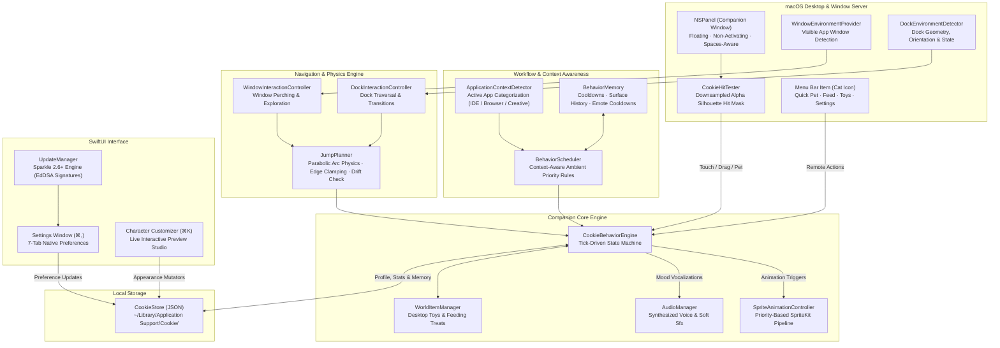
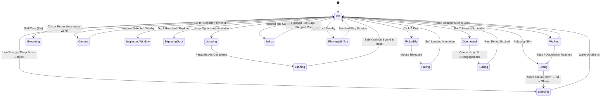

<div align="center">

  

  # Cookie 🐱

  **A quiet, warm, intelligent desktop companion that lives on your Mac.**  
  *No subscriptions. No cloud accounts. No telemetry. Just a delightful companion right on your desktop.*

  [-262421?style=flat-square&logo=apple&logoColor=white)](https://apple.com)
  [](https://github.com/MdKasif0/Cookie/releases)
  [-5d4d40?style=flat-square)](https://github.com/MdKasif0/Cookie)
  [](https://developer.apple.com/swift/)
  [-262421?style=flat-square)](website/appcast.xml)
  [](LICENSE)
  [](website/#privacy)
  [](https://github.com/MdKasif0/Cookie/releases)

</div>

---

## 📖 Overview

**Cookie** is a lightweight, offline desktop companion for macOS built with **SwiftUI** and **SpriteKit**. She roams your screen, leaps across window edges and the Dock, follows your cursor, and naps quietly beside your work—whisper-quiet on hardware (~0% idle CPU) and completely private.

---

## ✨ Key Features

| Feature | Highlight |
| :--- | :--- |
| **🐾 Desktop Companion** | Borderless floating panel that lives across all macOS Spaces without stealing focus. |
| **🪟 Window & Dock Jumping** | Traverses window edges and the macOS Dock with parabolic physics leaps. |
| **🧠 Context Awareness** | Automatically adapts energy and curiosity to your active workflow (IDEs, browsers). |
| **🫳 Tactile Interactions** | Zone-aware petting, physics dragging, and transparent click-through hit testing. |
| **🧶 Toys & Treats** | Interactive desktop items (yarn, mouse, cardboard box) and snack rewards. |
| **🎨 Character Studio (⌘K)** | 10 fur palettes, coats, eye styles, body scaling, and layered accessories. |
| **🎵 Synthesized Audio** | Procedural purrs, chirps, and meows with independent volume buses. |
| **🔒 100% Private & Offline** | Zero analytics, zero cloud dependencies, and local JSON storage. |
| **🔄 Seamless Updates** | Secure in-app updates via Sparkle with cryptographic EdDSA verification. |

---

## 🏗️ Architecture & Engine

### High-Level System Architecture



---

### Behavior State Machine



---

## 🪟 Window & Dock Jumping

Cookie traverses application windows and the macOS Dock using physics-backed parabolic leaps (`JumpPlanner`):

* **Trajectory Physics**: Tuned reach (340 pt horizontal, 175 pt vertical up, 260 pt drop) with realistic arc velocities.
* **Corridor Safety**: Automatically clamps landing points within window top edges and cancels leaps if the target window moves mid-crouch.
* **Dock Traversal**: Detects Dock orientation (Bottom, Left, Right) and autohide state across single and multi-display setups.

---

## 🧠 Context-Aware Ambient Engine

Cookie observes your workflow to modulate her activity without invading privacy (`ApplicationContextDetector`):

* **Focused Work (IDEs / Text Editors)**: Adopts a calm demeanor, sleeping or quietly sitting beside your editor.
* **Casual Use (Browsers / Creative Apps)**: Shows gentle curiosity, following cursor movement from a polite distance.
* **100% Private**: Uses public `NSWorkspace` app notifications exclusively—never reads keystrokes, window titles, or screen pixels.

---

## 🧶 Desktop World Items & Toys

Spawn interactive items via the status menu for immediate play and feeding:

* **Toys**: Yarn Ball, Feather, Toy Mouse, Fish Toy, Tennis Ball, and a **Cardboard Box** she can hop inside and peek out of.
* **Treats**: Fish, Milk, Chicken, and Cookies that trigger contented purrs, ear twitches, and celebratory emotes.

---

## 🎮 Direct Interactions

Cookie reacts to tactile cursor actions across anatomical touch zones:

| Action | Input | Reaction |
| :--- | :--- | :--- |
| **Pet & Scratch** | Click nose, head, belly, feet, or tail | Purrs, grins, sneezes, or playful paw hops. |
| **Pick Up & Drop** | Click & drag / release | Carried pose; drops with cushioned landing audio. |
| **Play Burst** | Double-click | Quick playful hop or energetic jump. |
| **Over-Petting** | Rapid clicks past tolerance | Mild protest ("hmph") and brief sulk before returning to normal. |

---

## 🎨 Personalities & Customization

* **6 Personalities**: Sleepy, Playful, Affectionate, Energetic, Curious, and Grumpy—each with unique pet tolerance and cadence.
* **Studio (⌘K)**: 10 warm fur palettes, 4 coats (Solid, Tuxedo, Siamese, Tabby), 3 eye styles, body scaling, and layered vector accessories (collars, bows, glasses, hats).

---

## ⚙️ Native Settings (⌘,)

Seven native preference tabs:
* **General**: Login item (`SMAppService`), desktop visibility, and multi-display coordinate recall.
* **Appearance**: Scale slider, 30/60 FPS toggle, and macOS Reduced Motion support.
* **Sound**: Master, meow, and interaction volume controls with ambient purring toggles.
* **Behavior**: Cadence (Calm / Balanced / Lively), window jumping, dock exploration, and cursor interactions.
* **Stats**: Lifetime pets, favorite petting spots, jumps completed, and friendship progress.
* **Privacy & About**: Local data residency confirmation, Sparkle update checks, and version info.

---

## 🔄 In-App Updates

Integrated with **Sparkle 2.6+**:
* **Cryptographic Security**: Every release binary is validated with EdDSA (ed25519) digital signatures.
* **Cozy Dialog (`UpdatePromptView`)**: Native SwiftUI prompt with release highlights, install & relaunch, and snooze/skip options.

---

## 📂 Project Structure

```
Cookie/
├── Cookie/
│   ├── Animation/       # SpriteAnimationController, texture slicers, frame caches
│   ├── App/             # Entry point, AppDelegate, WindowManager
│   ├── Assets/          # Asset catalogs, AppIcon, CookieArt
│   ├── Audio/           # AudioManager, sound synthesis engine
│   ├── Behaviors/       # CookieBehaviorEngine, BehaviorScheduler, BehaviorMemory
│   ├── Context/         # ApplicationContextDetector & workflow classification
│   ├── Cookie/          # CompanionPanelController, NSPanel, CookieScene
│   ├── Dock/            # DockEnvironmentDetector, DockInteractionController
│   ├── MenuBar/         # Status item controller, companion menu
│   ├── Models/          # CookieProfile, CookieSettings, WorldItems
│   ├── Persistence/     # CookieStore (local JSON persistence)
│   ├── Settings/        # Native SwiftUI 7-tab preference panels
│   ├── Updates/         # UpdateManager (Sparkle 2.6+), UpdatePromptView
│   └── Window/          # JumpPlanner, WindowInteractionController
├── Packaging/           # Production DMG packaging script, HiDPI artwork, volume icon
├── scripts/             # Asset generators, sound synthesizer, update signing
└── website/             # Product showcase site and appcast feed
```

---

## 🚀 Building & Developing

**Requirements**: macOS 14.0+, Xcode 15.0+, and [XcodeGen](https://github.com/yonaskolb/XcodeGen) (`brew install xcodegen`).

```bash
# 1. Generate Xcode project & build
xcodegen generate
xcodebuild -scheme Cookie -configuration Release -derivedDataPath .build/DerivedData build

# 2. Package production DMG
./Packaging/build_dmg.sh
```

---

## 📦 Distribution

* **Binary**: Universal 2 (`arm64` + `x86_64`)
* **DMG**: Self-contained ~23 MB image (`Cookie-1.1.0.dmg`, UDZO) with custom HiDPI artwork and `.VolumeIcon.icns`.
* **Data Path**: `~/Library/Application Support/Cookie/cookie-store.json`

For signing and notarization workflows, see [DISTRIBUTION.md](DISTRIBUTION.md).

---

## 📄 License

Free and open-source software under the [MIT License](LICENSE). Crafted with care by [Md Kasif Uddin](https://github.com/MdKasif0).
